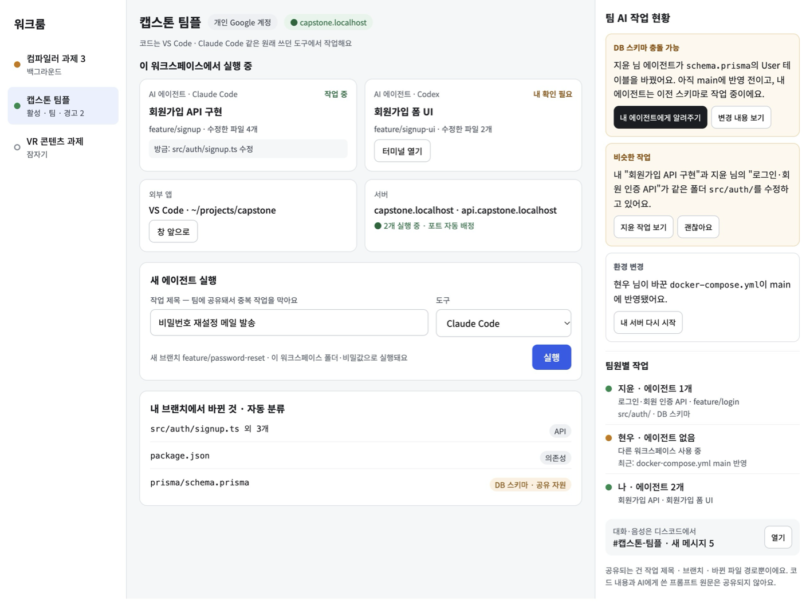
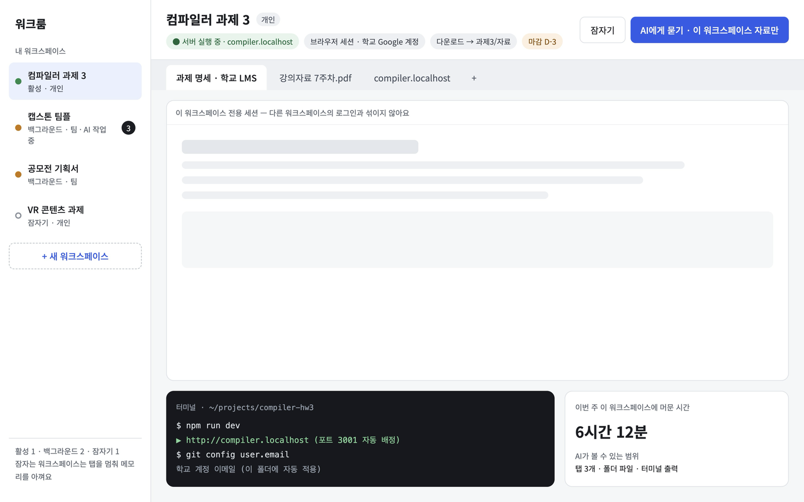
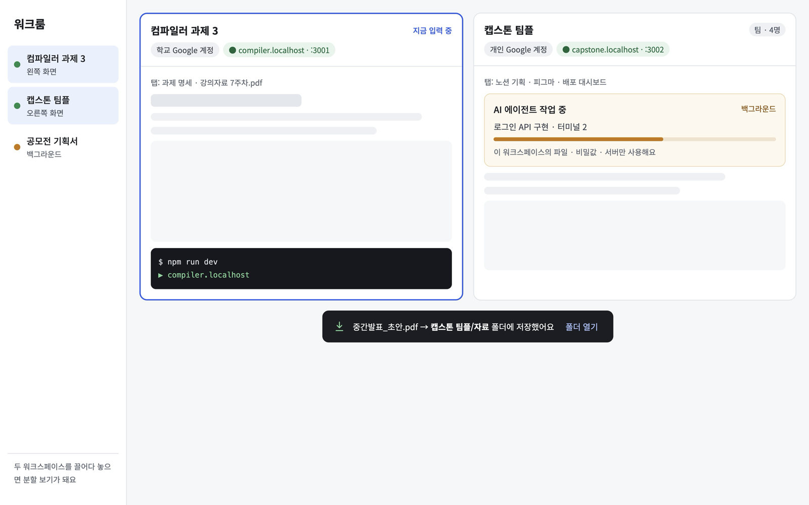
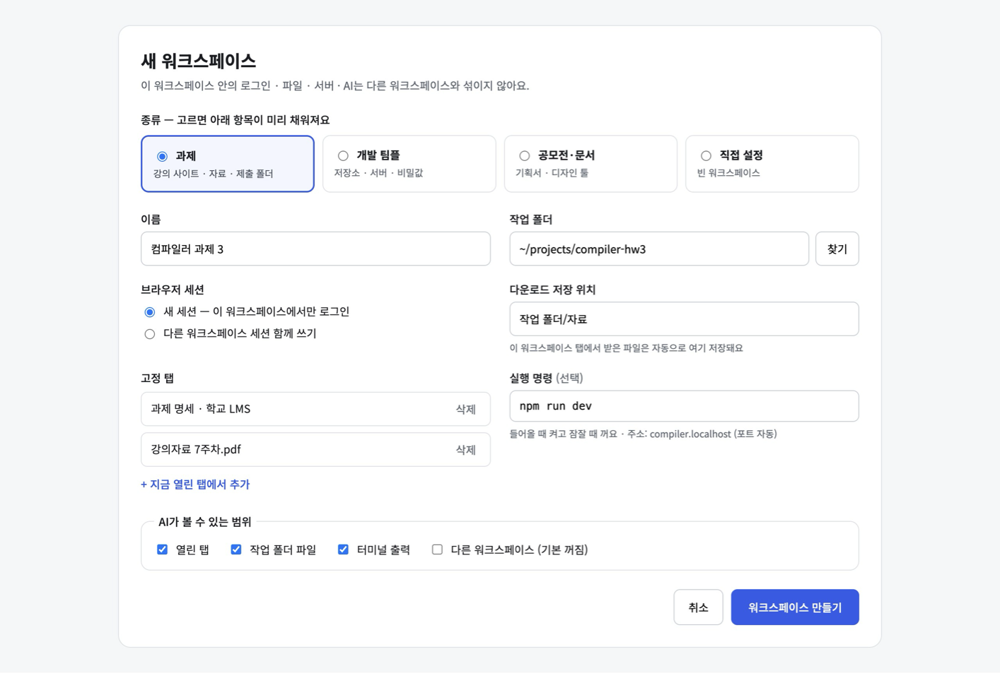
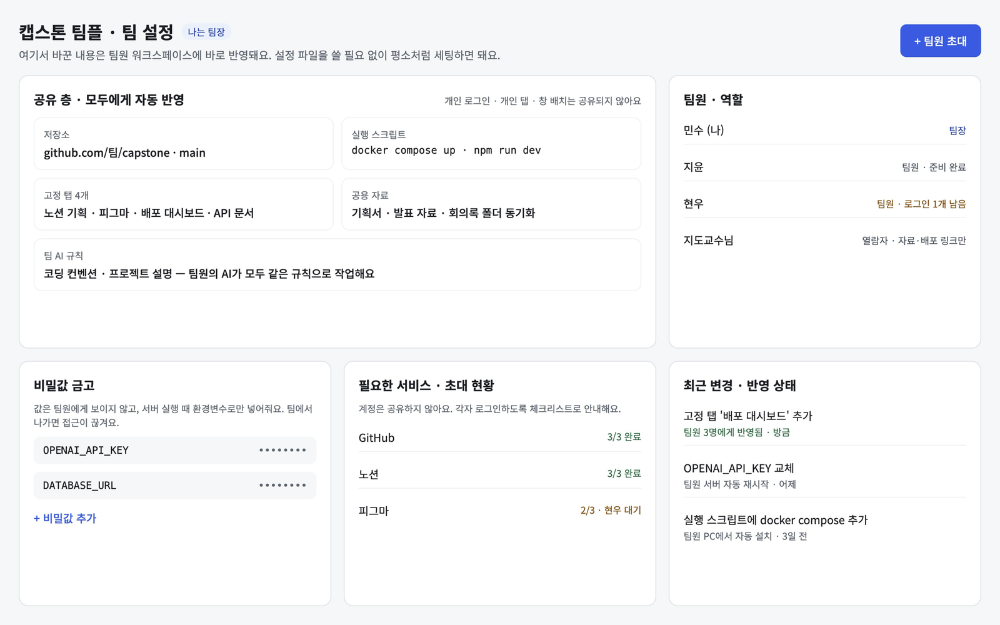
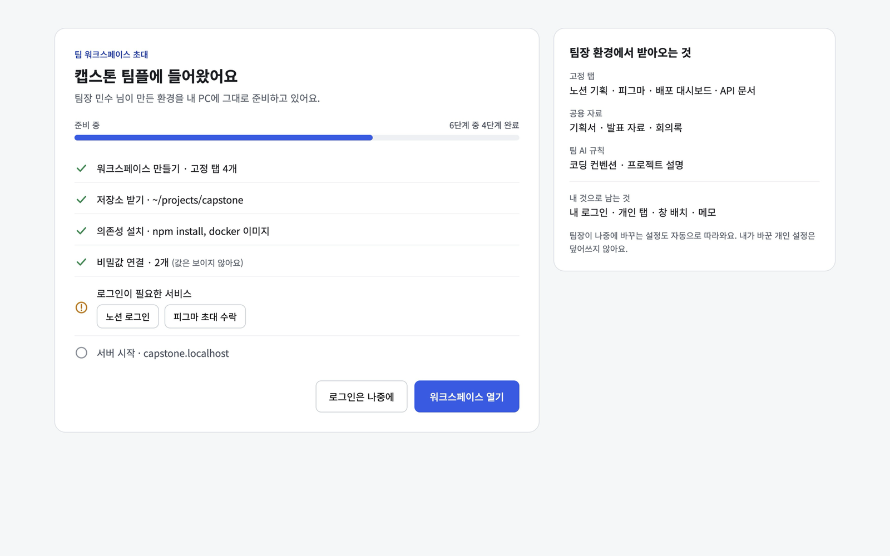

# Cadora

> 프로젝트마다 독립된 컴퓨터를 한 대씩 갖는 것처럼, 계정·파일·서버·AI 작업 환경을 분리하고 팀에는 같은 작업 환경을 배포하는 데스크톱 앱.



- **플랫폼**: Windows 11 우선 (Electron), macOS 후속
- **상태**: PRD v1.1 초안 단계 — 상세 요구사항은 [`docs/PRD.md`](docs/PRD.md)

## 왜 만드나

여러 과제·팀 프로젝트를 동시에 진행하면 브라우저 로그인, 다운로드 파일, 서버 포트, 환경변수가 한 컴퓨터 안에서 뒤섞입니다. AI 코딩 에이전트를 병렬로 쓰면 팀원끼리 같은 일을 맡기거나 DB 스키마·의존성을 서로 모르게 바꾸는 일이 생깁니다.

Cadora는 다음 세 가지를 해결합니다.

1. **프로젝트 간 혼선 감소** — 로그인·파일·실행 환경을 워크스페이스 단위로 분리
2. **팀 온보딩 단순화** — 팀장이 구성한 공통 환경을 팀원이 초대 수락만으로 받아 시작
3. **AI 병렬 작업 조율** — 에이전트 실행 상태와 변경 파일 메타데이터로 충돌 가능성을 머지 전에 경고

Cadora는 에디터나 AI 모델을 직접 만들지 않습니다. VS Code, Claude Code, Codex, Discord 같은 기존 도구를 **연결·실행·관찰**하는 상위 레이어입니다.

## 주요 기능 (MVP / P0)

| 영역 | 기능 | FR |
|---|---|---|
| 워크스페이스 | 생성·목록, 활성/백그라운드/잠자기 상태 | FR-01, FR-04 |
| 격리 | 워크스페이스별 브라우저 세션(partition), 터미널 cwd·환경변수, 다운로드 폴더 | FR-02, FR-03, FR-05 |
| 팀 | 생성·초대·역할, 공유 층/개인 층 분리 동기화, 온보딩 체크리스트 | FR-07 ~ FR-09 |
| AI 작업 | CLI 에이전트 실행·상태, 파일/Git 변경 감시, Claude Code Hooks | FR-11 ~ FR-13 |
| 팀 조율 | 팀 AI 작업 현황 패널, 규칙 기반 충돌 가능성 경고 | FR-14, FR-15 |
| 보호 | 최소 메타데이터 공유, 비밀값 마스킹 | FR-18, FR-19 |

**P0 핵심 데모**: 두 기기에서 팀 워크스페이스를 쓰는 중 A의 Claude Code가 `schema.prisma`를 수정하면, B의 팀 AI 작업 현황에 충돌 가능성 경고가 표시된다.

### 팀과 공유하는 것 / 하지 않는 것

| 공유함 (최소 메타데이터) | 공유하지 않음 |
|---|---|
| 작업 제목, 에이전트 상태, 브랜치, 상대 파일 경로, 변경 분류, 경고 | 코드 본문, 프롬프트 원문, 로그인 쿠키·토큰, 개인 워크스페이스 이름, OS 절대경로 |

## UI 시안

> 와이어프레임 단계 시안입니다. 이미지 안의 "워크룸"은 이전 가칭이며 Cadora로 바뀝니다.

### 1. 홈 · 개인 워크스페이스
사이드바에서 워크스페이스 상태(활성·백그라운드·잠자기)를 보고 전환합니다. 워크스페이스마다 전용 브라우저 세션, 고정 탭, 다운로드 폴더, 터미널, 로컬 서버 주소(`compiler.localhost`)가 따로 있습니다. (FR-01 ~ FR-05)



### 2. 다중 워크스페이스 동시 보기
두 워크스페이스를 나란히 띄워 서로 다른 계정·서버를 유지합니다. 한쪽에서 받은 파일은 해당 워크스페이스 폴더로 들어가고, 백그라운드 쪽의 AI 에이전트는 계속 실행됩니다. (FR-02, FR-04, FR-05)



### 3. 새 워크스페이스 만들기
종류(과제·개발 팀플·공모전·직접 설정)를 고르면 기본값이 채워집니다. 작업 폴더, 브라우저 세션, 다운로드 위치, 고정 탭, 실행 명령, AI가 볼 수 있는 범위를 설정합니다. (FR-01)

<p align="center"></p>

### 4. 팀 설정 (팀장)
공유 층(저장소, 실행 스크립트, 고정 탭, 공용 자료, 팀 AI 규칙)을 관리하면 팀원 모두에게 반영됩니다. 팀원 역할, 비밀값 금고, 필요한 서비스 초대 현황, 최근 변경 반영 상태도 여기서 봅니다. (FR-07, FR-08, FR-10)



### 5. 팀원 초대 · 온보딩
초대를 수락하면 저장소 클론, 의존성 설치, 비밀값 연결, 필요한 서비스 로그인, 서버 시작을 단계별로 진행합니다. 로그인은 나중에 하고 먼저 들어갈 수도 있습니다. (FR-09)



### 6. 팀 AI 작업 현황
이 워크스페이스에서 실행 중인 에이전트, 외부 앱, 서버를 보고 새 에이전트를 작업 제목과 함께 실행합니다. 오른쪽 패널에는 DB 스키마 충돌 가능, 비슷한 작업, 환경 변경 경고와 팀원별 작업이 나옵니다. (FR-11 ~ FR-17)

<p align="center"></p>

## 아키텍처 (제안)

```
[데스크톱 클라이언트: Electron]
  ├─ 워크스페이스/세션 관리자 ── BrowserView + session.fromPartition()
  ├─ 터미널·프로세스 관리자 ──── xterm.js + node-pty (Windows: PowerShell / ConPTY)
  ├─ 프로젝트 감시 ───────────── chokidar + simple-git
  ├─ 에이전트 어댑터 ─────────── CLI 실행 + Claude Code Hooks
  └─ 로컬 UI
              │ 인증된 실시간 이벤트 (최소 메타데이터)
              ▼
[팀 동기화 서버: Node/WebSocket 또는 Supabase Realtime — 미정]
  ├─ 사용자·팀·멤버십·초대
  ├─ 공통 구성 버전 관리
  ├─ 에이전트 실행·파일 변경 이벤트
  └─ 규칙 기반 위험 감지·경고
```

OS 의존 기능(파일 시스템, 셸·프로세스, 외부 앱 연동)은 macOS 확장을 위해 별도 어댑터로 분리합니다.

## 개발 환경

| 항목 | 버전 |
|---|---|
| OS | Windows 11 (주 개발·테스트), macOS (보조) |
| Node.js | 22 LTS (`.nvmrc`) |
| 패키지 매니저 | npm |
| 필수 아님 | WSL2, Docker Desktop |

```bash
nvm use            # 또는 Node 22 설치
npm ci
npm run dev
```

### npm 스크립트 규약

CI/CD는 아래 스크립트 이름을 기준으로 동작합니다. 스크립트가 없으면 해당 단계는 건너뜁니다.

| 스크립트 | 용도 | 사용처 |
|---|---|---|
| `lint` | ESLint 등 정적 검사 | CI |
| `typecheck` | `tsc --noEmit` | CI |
| `test` | 단위/통합 테스트 | CI |
| `build` | 앱 번들 빌드 | CI |
| `dist` | electron-builder 패키징, 결과물은 `release/` | CD |

electron-builder 설정에 `directories.output: "release"`를 지정하세요.

## 협업 규칙

### 브랜치

```
feat/*, fix/* ──PR(squash, 자동 머지)──▶ dev ──PR(merge commit, 직접 병합)──▶ main ──태그──▶ Release
hotfix/*      ──PR(직접 병합)──────────────────────────────────────────────▶ main
```

| 브랜치 | 역할 | 병합 방식 |
|---|---|---|
| `dev` (기본 브랜치) | 개발 통합. 모든 작업 PR의 대상 | squash, CI·PR 제목 통과 시 **자동 머지** |
| `main` | 최종본(릴리스). `dev`·`hotfix/*`에서 온 PR만 허용 | **merge commit**, 관리자가 직접 병합 |
| `<type>/<설명>` | 작업 브랜치 — 예: `feat/browser-partition`, `fix/pty-kill-tree` | — |

- `dev`→`main`은 반드시 **"Create a merge commit"**으로 병합합니다. squash하면 두 브랜치 히스토리가 갈라져 다음 릴리스 PR에서 충돌이 납니다.
- `hotfix/*`로 `main`을 고쳤다면 같은 변경을 `dev`에도 PR로 반영합니다.

### 커밋 / PR 제목

[Conventional Commits](https://www.conventionalcommits.org/ko/) 형식을 사용합니다. squash merge 시 **PR 제목이 그대로 커밋 메시지**가 되므로 PR 제목은 CI에서 검사합니다.

```
feat(workspace): 워크스페이스별 브라우저 세션 분리 (FR-02)
fix(terminal): Windows 프로세스 트리 종료 누락 수정
release: v0.1.0                      # dev → main
```

허용 type: `feat` `fix` `docs` `style` `refactor` `perf` `test` `build` `ci` `chore` `revert` `release`

### PR 흐름

1. 이슈 생성 (기능 요청 템플릿에 FR 번호·우선순위 기입)
2. `dev`에서 브랜치 생성 → 작업 → `dev`로 PR 생성 (PR 템플릿 작성)
3. PR을 열면 자동 머지가 켜지고, **CI(`ci-passed`)와 PR 제목 검사(`pr-title`)가 통과하면 자동으로 squash merge** 후 브랜치 삭제 (리뷰 승인은 필수 아님)
4. 아직 머지되면 안 되는 PR은 **Draft**로 열거나 Draft로 전환 → 자동 머지 해제. Ready for review로 바꾸면 다시 켜짐
5. 릴리스할 때 `dev` → `main` PR(`release: vX.Y.Z`)을 열고 관리자가 merge commit으로 병합
6. Dependabot은 `dev`로 PR을 올립니다. 메이저 업데이트는 자동 머지되지 않으므로 직접 검토 후 머지

## CI/CD

| 워크플로 | 트리거 | 하는 일 |
|---|---|---|
| [`ci.yml`](.github/workflows/ci.yml) | `dev`·`main` PR/push | Windows에서 `npm ci` → lint → typecheck → test → build. 브랜치 보호용 단일 체크 `ci-passed` |
| [`pr-lint.yml`](.github/workflows/pr-lint.yml) | PR 생성·수정 | PR 제목 Conventional Commits 검사(`pr-title`), `main` PR 출처 검사(`source-branch`) |
| [`auto-merge.yml`](.github/workflows/auto-merge.yml) | `dev` PR 생성·Draft 전환 | Draft가 아닌 PR에 auto-merge(squash) 활성화, Draft 전환 시 해제. Dependabot은 patch/minor만 |
| [`discord-notify.yml`](.github/workflows/discord-notify.yml) | PR 열림·머지·닫힘, CI 실패 | Discord 채널로 알림 (`DISCORD_WEBHOOK_URL` 필요) |
| [`cd.yml`](.github/workflows/cd.yml) | `main` push, `v*` 태그 | Windows 설치 파일 빌드 → Actions artifact 업로드. 태그면 GitHub Release(draft) 생성 |

> 자동 머지는 `GITHUB_TOKEN`으로 이루어져 `dev` push CI와 "머지됨" Discord 알림을 트리거하지 않습니다. `main` 병합은 사람이 하므로 CD·알림이 정상 동작합니다.

### 릴리스

```bash
# dev → main PR 을 merge commit 으로 병합한 뒤
git checkout main && git pull
npm version minor          # package.json 버전 갱신 + 태그 생성
git push --follow-tags     # cd.yml 이 Release 초안 생성 → 확인 후 Publish
```

### 저장소 초기 설정 (관리자 1회)

1. **Settings → General**
   - Default branch: `dev`
   - Pull Requests: `Allow merge commits`·`Allow squash merging` 켜기, `Allow rebase merging` 끄기
   - `Allow auto-merge`, `Automatically delete head branches` 켜기
2. **Settings → Branches → 보호 규칙**
   - `dev`: Require a pull request (필수 승인 0명), status checks `ci-passed`, `pr-title`
   - `main`: Require a pull request (필수 승인 0명), status checks `ci-passed`, `pr-title`, `source-branch`
3. **라벨 생성**: `feature`, `bug`
4. **(선택) Secrets**
   - `AUTOMERGE_TOKEN`: GitHub App 토큰 또는 fine-grained PAT. 등록하면 `dev` 자동 머지 후에도 CI·알림이 트리거됩니다.
   - `DISCORD_WEBHOOK_URL`: Discord 서버 설정 → 연동 → 웹후크 → 새 웹후크(알림 받을 채널 선택) → URL 복사 후 `gh secret set DISCORD_WEBHOOK_URL`로 등록
   - `WIN_CSC_LINK`, `WIN_CSC_KEY_PASSWORD`: Windows 코드 서명 인증서 (없으면 미서명 빌드)

<details>
<summary>gh CLI로 설정하기</summary>

```bash
REPO=gymdong/SW_cadora

gh api -X POST repos/$REPO/git/refs -f ref=refs/heads/dev \
  -f sha=$(gh api repos/$REPO/git/ref/heads/main -q .object.sha)

gh repo edit $REPO --default-branch dev \
  --enable-squash-merge --enable-merge-commit --enable-rebase-merge=false \
  --enable-auto-merge --delete-branch-on-merge

gh label create feature --color 1D76DB -R $REPO
gh label create bug     --color D73A4A -R $REPO

protect() {  # $1=branch, $2=checks JSON array
  gh api -X PUT repos/$REPO/branches/$1/protection --input - <<EOF
{
  "required_status_checks": { "strict": true, "contexts": $2 },
  "enforce_admins": false,
  "required_pull_request_reviews": { "required_approving_review_count": 0 },
  "restrictions": null
}
EOF
}
protect dev  '["ci-passed","pr-title"]'
protect main '["ci-passed","pr-title","source-branch"]'
```

</details>

## 일정 (한 학기, 추정)

| 주차 | 산출물 |
|---|---|
| 1–2 | Electron 기본 화면, 로컬 저장 구조, 워크스페이스 모델 |
| 3–4 | 독립 브라우저 세션, 터미널, 프로세스 실행, 다운로드 라우팅 |
| 5–6 | CLI 에이전트 실행, Git/파일 감시, 로컬 작업 상태 패널 |
| 7–9 | 사용자/팀 인증, 초대, 공유 층·개인 층 동기화, 온보딩 |
| 10–11 | Claude Code Hooks, 이벤트 규격, 팀 실시간 상태 |
| 12–13 | 유사 작업·스키마·환경 파일 경고, 알림 근거 |
| 14–15 | 두 기기 통합 테스트, 보안·예외 처리, 발표 시연 |

## 미결정 사항

- 팀 동기화 서버: 자체 Node/WebSocket vs Supabase Realtime
- 비밀값 저장: 자체 금고 / OS 키체인 / 외부 비밀관리 서비스
- 공식 지원 에이전트 범위: Claude Code만 vs Codex 포함
- 팀 변경 적용 방식: 즉시 자동 vs 사용자 승인 후
