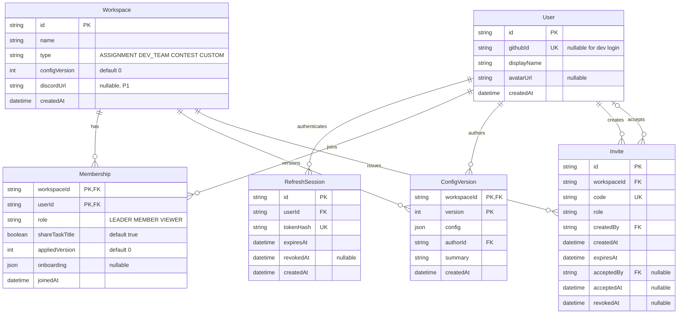
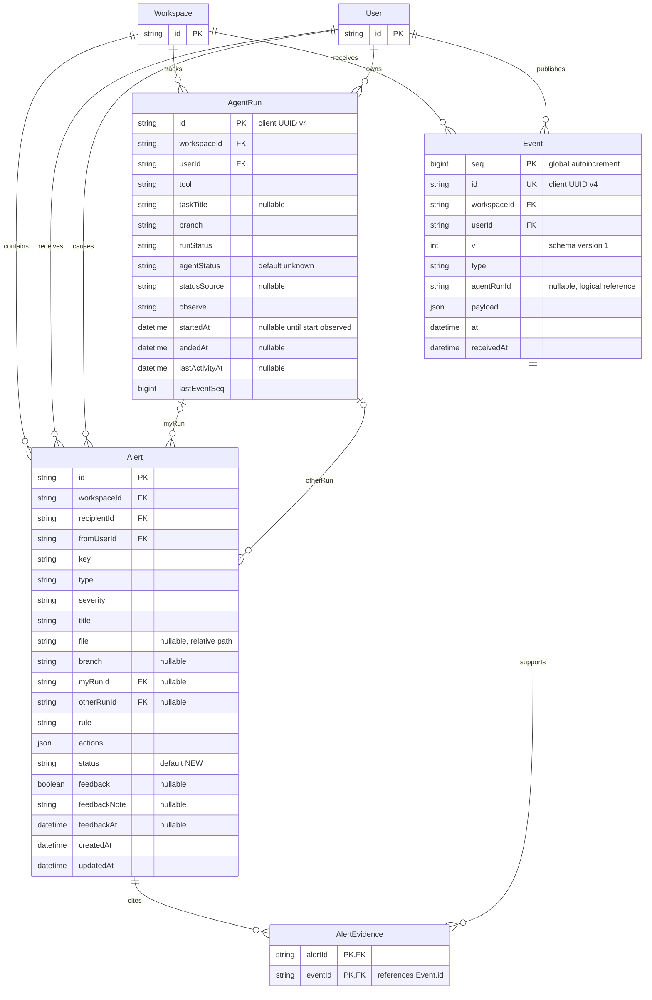
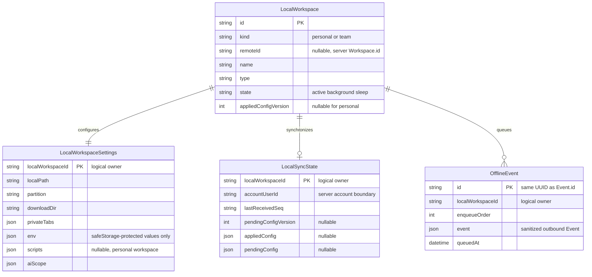

# Cadora 데이터 모델 ERD

| 항목 | 내용 |
|---|---|
| 버전 | v0.1 (설계 제안, 구현 전) |
| 작성일 | 2026년 11월 24일 |
| 기준 | [API.md](API.md) v0.1 · [ARCHITECTURE.md](ARCHITECTURE.md) v0.1 · [PRD.md](PRD.md) v1.3 |
| 범위 | P0 서버 관계형 모델, 데스크톱 로컬 저장 모델, P1 확장 경계 |

팀 데이터는 서버 PostgreSQL에, 개인 워크스페이스와 팀 워크스페이스의 개인 설정은 데스크톱 JSON에 저장한다. 팀 하나가 서버 `Workspace` 하나이므로 별도 `Team` 테이블은 두지 않는다. 공유 설정은 버전별 JSON 스냅샷을 유지한다.

아래 ERD는 ARCHITECTURE §6의 초안을 API에서 필요한 필드와 관계로 보완한 **논리 설계**다. 실제 Prisma 스키마나 마이그레이션은 아니며, 추가 설계와 미결정 사항은 §7에 구분했다.

## 1. 표기와 저장 원칙

- `PK`: 기본키, `FK`: 외래키, `UK`: 단일 열 고유키. 복합 고유키는 §5에 별도로 적는다.
- `nullable` 주석이 있는 필드만 NULL을 허용한다. `||`는 정확히 1개, `o|`는 0 또는 1개, `o{`는 0개 이상이다.
- `string`은 논리 문자열 타입이다. 서버 생성 리소스 ID는 cuid, `AgentRun.id`와 `Event.id`는 클라이언트 생성 UUID v4다. 로컬 ID 생성 방식은 별도다.
- `datetime`은 UTC 저장을 뜻한다. PostgreSQL 구현 시 시각 열은 timezone을 포함하는 타입을 사용한다.
- `json`은 구조화된 DTO다. 자유 입력 원본을 그대로 저장하는 필드가 아니며, API 스키마와 공개 범위 검사를 통과한 값만 저장한다.
- 다이어그램을 읽기 쉽게 관리 영역과 실행 영역으로 나눴다. 양쪽의 `User`, `Workspace`는 같은 테이블이다.

## 2. 서버 ERD — 사용자와 팀 환경



### 2.1 팀과 멤버십

`User`와 `Workspace`는 `Membership`을 통한 N:M 관계다. 한 사용자가 여러 팀에 속할 수 있고, 역할과 작업 제목 공개 여부는 팀마다 다를 수 있다. 팀 생성자는 같은 트랜잭션에서 `LEADER` 멤버십을 얻는다(API §1.3).

`configVersion = 0`은 아직 공유 스냅샷이 없다는 뜻이다. `appliedVersion = 0`은 아직 적용한 버전이 없다는 뜻이다. 두 열은 0을 허용하므로 `ConfigVersion`에 직접 FK를 걸지 않는다. 양수이면 **같은 워크스페이스의 존재하는 버전**이어야 하며, `appliedVersion <= configVersion`을 서비스 계층에서 검증한다. 현재 버전과 전체 스냅샷 저장은 하나의 트랜잭션으로 처리한다.

`Membership.onboarding`은 API §1.6의 전체 `onboarding` 객체를 저장한다.

```json
{
  "steps": [
    { "id": "clone", "status": "done" },
    { "id": "install", "status": "pending" }
  ],
  "services": [{ "id": "service_github", "done": true }]
}
```

단계 ID는 `clone | install | secrets | services | server`, 상태는 `pending | running | done | failed | skipped`다. `detail`에는 정제한 오류 요약만 넣으며 명령 로그·비밀값·절대경로는 넣지 않는다. 서비스 ID는 적용 대상 스냅샷의 `services[].id`와 연결하는 논리 참조다.

### 2.2 공유 설정 스냅샷

`ConfigVersion`은 `(workspaceId, version)`마다 전체 `SharedConfig`를 보존한다(API §1.4). 다음 항목은 **별도 서버 테이블로 분해하지 않는다**. 과거 버전 조회와 클라이언트 diff 계산에 같은 시점의 구성이 필요하기 때문이다.

| JSON 필드 | 저장 내용 |
|---|---|
| `repo` | `{ url, baseBranch }` 또는 null |
| `scripts[]` | id, name, command, autoStart, requiresApproval, port?, host? |
| `pinnedTabs[]`, `materials[]` | id, title, url; 자료는 링크만 |
| `services[]` | id, name, url |
| `aiRules` | `{ path, content }` 또는 null; 의도적으로 공유하는 AI 규칙 |
| `secrets[]` | `{ name }`만; 실제 비밀값 제외 |
| `watch` | `{ extraIgnore: string[] }` |

배열의 ID는 스냅샷 간 동일 항목을 식별하도록 유지한다. 배열 내부 ID와 비밀값 이름의 중복은 스키마 검증으로 막는다. `aiRules.content`는 명시적 공유 설정이므로 이벤트의 `content` 금지 검사와 구분한다. 실행 중 코드·프롬프트를 이 필드에 수집하지 않는다.

### 2.3 초대와 인증 세션

초대는 생성자 1명과 수락자 최대 1명을 갖는다. `acceptedBy`, `acceptedAt`은 함께 설정하며 수락은 멤버십 생성과 원자적으로 처리한다. 단일 수락 초대는 ARCHITECTURE의 `acceptedBy`를 따른 설계 제안이다. 여러 사람이 쓰는 초대 링크가 필요하면 별도 수락 이력 테이블이 필요하다.

대기·수락·만료·회수 상태는 필드로 계산한다. 대기 목록은 `acceptedBy IS NULL AND revokedAt IS NULL AND expiresAt > now()`다. 만료·회수는 API의 410으로 처리하고, 이미 수락한 초대의 재요청 정책은 §7에서 다룬다.

`RefreshSession`은 갱신·로그아웃(API §1.1)을 지원하기 위한 추가 설계다. 원본 refresh token 대신 해시를 저장한다. 갱신 시 이전 행을 폐기하고 새 토큰/행을 발급하는 작업을 원자적으로 처리하며, 로그아웃은 해당 세션을 폐기한다. access JWT는 테이블에 저장하지 않는다. Device Flow의 일시적인 코드는 만료가 있는 인증 상태로 취급하며 핵심 ERD에서 제외한다.

## 3. 서버 ERD — 에이전트 실행과 경고



### 3.1 이벤트와 실행 상태

`Event`는 수신 이력이고, `AgentRun`은 이벤트로부터 구성하는 현재 상태의 요약이다. 이 요약으로 `GET /workspaces/:id/runs?active=true`를 전체 이력 재계산 없이 반환한다(API §1.7, PRD FR-11). 개인 워크스페이스의 실행은 서버에 저장하지 않는다.

`runStatus`와 `agentStatus`는 별개의 상태다. `done`은 프로세스 종료를 의미하지 않는다.

| 필드 | 값 |
|---|---|
| `tool` | `claude-code`, `codex`, `other` |
| `runStatus` | `running`, `stopped`, `exited`, `error` |
| `agentStatus` | `working`, `waiting`, `idle`, `done`, `unknown` |
| `statusSource` | `herdr`, `hook`, `process` |
| `observe` | `hooks`, `herdr`, `process` |

`active=true`는 `runStatus = running`으로 해석하는 안이다. 온라인 여부와 실행 상태를 분리하며, 연결 해제만으로 실행 종료를 판정하지 않는다. `lastActivityAt`은 마지막 활동 시각, `lastEventSeq`는 요약에 반영한 마지막 이벤트 순번이다.

`Event.payload`에는 공통 열을 제외한 타입별 추가 필드를 저장하고, 응답에서는 공통 열과 합쳐 API의 이벤트 형태를 복원한다.

| `type` | `agentRunId` | `payload` 내용 |
|---|---|---|
| `agent_run` | 필수 | tool, taskTitle, branch, status, observe |
| `agent_status` | 필수 | status, source |
| `agent_activity` | 필수 | activity (`user_input`, `tool_use`, `turn_end`) |
| `file_change` | NULL 가능 | tool, taskTitle, branch, relativePath, changeType, category, source |

`changeType`은 `added / modified / deleted`, `category`는 `db-schema / dependency / infra / test / api / ui / docs / code`다. 파일은 독립 엔터티로 만들지 않고 변경 당시의 상대경로를 기록한다.

**지연 도착 처리 제안**: `Event.agentRunId`는 실행 등록보다 이벤트가 먼저 도착할 수 있어 물리 FK를 두지 않는다. 알려진 실행이면 워크스페이스와 소유자가 일치하는지 검증한다. 미등록 실행이면 메타데이터 도착 후 검증하고 요약에 반영하며, 검증 전에는 해당 실행의 경고 판단에 사용하지 않는다. 시작을 관측하지 못한 종료 이벤트로 요약을 만들 때는 `startedAt`을 NULL로 둔다. 다른 사용자나 팀의 실행 UUID 재사용은 거부한다.

### 3.2 수신자별 경고와 근거

`Alert`는 수신자마다 1행을 저장한다. 고유키는 `(workspaceId, recipientId, key)`이므로 같은 원인이라도 수신자가 다르면 별도 경고다. PRD의 `RiskAlert`를 ARCHITECTURE와 API에 맞춰 `Alert`로 명명했다.

`AlertEvidence`는 경고와 이벤트의 N:M 중간 테이블이다. ARCHITECTURE의 이벤트 ID 배열을 관계로 표현하며, API에서는 기존처럼 `evidence: Event.id[]`로 반환한다. 근거 목록은 `Event.seq` 순서로 정렬한다. 생성 시 근거가 최소 1개 있어야 한다는 규칙은 서비스에서 검증한다. 그림의 `o{`는 FK만으로 최소 1행을 강제할 수 없음을 나타낸다.

`myRunId`는 수신자의 실행, `otherRunId`는 상대의 실행이다. `sim` 경고에서는 두 값을 필수로 검증한다. 경고·실행·근거 이벤트가 모두 같은 팀에 속하고, 각 실행 소유자가 해당 사용자와 일치하는지도 검증한다.

| DB 필드 | API 대응 |
|---|---|
| `type` | DB `DB / DEP / ENV / SIM` ↔ API `db / dep / env / sim` |
| `severity` | DB `HIGH / MEDIUM / INFO` ↔ API `high / medium / info` |
| `status` | DB `NEW / DISMISSED / NOTIFIED / HANDLED` ↔ API `new / dismissed / notified / handled` |
| `actions` | `notify / evidence / restart / peek / dismiss` 중 허용된 작업 배열 |
| `feedback`, `feedbackNote` | 입력 `useful`, `note`. 미응답 NULL과 부정 평가 false를 구분 |

피드백은 최신 응답을 덮어쓰는 안으로 설계했다. 액션 `dismiss / notified / handled`를 상태로 변환한다. `notify`는 화면에 표시할 작업이고, `notified`는 로컬 에이전트에 전달을 완료한 결과다. 원문 프롬프트와 전달 본문은 서버에 저장하지 않는다.

## 4. 로컬 저장 모델

아래는 `workspaces.json`의 객체 관계다. SQL 테이블이나 서버 FK가 아니다(ARCHITECTURE §6, API §3). 동기화 캐시와 키 구성은 추가 설계안이다.



- `personal`은 `remoteId`가 없고, `team`은 서버 Workspace ID를 가진다. 동기화 상태와 송신 큐는 팀에만 존재한다. 같은 팀이라도 기기별 로컬 설정은 다르다.
- `LocalWorkspaceSettings`는 실제로 `LocalWorkspace.settings`에 포함할 수 있다. 이 경우 그림의 부모 식별용 `localWorkspaceId`는 생략한다.
- 송신 큐는 계정과 팀에 연결한다. 로그아웃 후 다른 계정으로 재전송하지 않는다. 같은 UUID로 재전송하며 `ack`를 받은 뒤 삭제한다. 수신 커서는 송신 ACK와 별도로, 순서대로 영속화한 수신 이벤트를 기준으로 갱신한다.
- 설정의 다운로드와 실제 적용을 구분한다. 승인 및 적용이 완료되면 `appliedConfigVersion`을 갱신한다. 즉시 적용 항목과 승인 대기 항목이 섞여 있으면 `pendingConfig`도 보관한다.
- `env` 값은 safeStorage로 보호해 저장한다. Cookie와 로그인 세션은 Electron partition에, 터미널 내용·실행 핸들·Hook 토큰은 런타임에 속한다.
- 멤버 API의 `online`과 WS의 `active / background / sleep / elsewhere / offline`은 연결과 heartbeat에서 계산하는 일시적인 상태다. 멤버 테이블에 영구 저장하지 않는다.

## 5. 키와 인덱스

| 엔터티 | 제약 및 인덱스 | 용도 |
|---|---|---|
| User | PK `id`; UNIQUE `githubId` (NULL 가능) | GitHub 계정 중복 방지 |
| RefreshSession | PK `id`; UNIQUE `tokenHash`; INDEX `userId`, `expiresAt` | 토큰 검증·세션 폐기·만료 정리 |
| Workspace | PK `id`; `configVersion >= 0` | 현재 버전 관리 |
| Membership | PK `(workspaceId, userId)`; INDEX `userId` | 중복 가입 방지·내 팀 목록 |
| ConfigVersion | PK `(workspaceId, version)`; `version >= 1` | 버전 중복 방지·이력 조회 |
| Invite | PK `id`; UNIQUE `code`; INDEX `(workspaceId, expiresAt)` | 코드 조회·팀 초대 목록 |
| AgentRun | PK `id`; INDEX `(workspaceId, runStatus)`, `(workspaceId, userId)` | 실행 중 목록·소유자별 실행 |
| Event | PK `seq`; UNIQUE `id`; INDEX `(workspaceId, seq)`, `(workspaceId, agentRunId, seq)` | 중복 제거·재접속 재생·실행별 이력 |
| Alert | PK `id`; UNIQUE `(workspaceId, recipientId, key)`; INDEX `(workspaceId, recipientId, status, createdAt)` | 수신자별 중복 방지·상태별 조회 |
| AlertEvidence | PK `(alertId, eventId)`; INDEX `eventId` | 근거 중복 방지·역참조. `eventId`는 `Event.id` 참조 |

## 6. 쓰기 정합성과 삭제 정책

다음은 구현 시 적용할 설계안이다. 단순 FK로 표현할 수 없는 팀 일치와 권한 조건은 서비스에서 검증한다.

1. **설정 갱신**: `baseVersion`을 조건으로 현재 버전을 비교 갱신하고 새 스냅샷과 함께 커밋한다. 경합은 409로 반환하고 알림은 커밋 후 전송한다.
2. **이벤트 수신**: 토큰에서 userId를 확정하고 현재 멤버십·권한·공개 범위를 검사한다. 같은 UUID 재전송에는 기존 seq를 반환한다. 내용이나 발신자가 다른 UUID 재사용은 거부한다. 중복 수신으로 상태와 경고를 다시 생성하지 않는다.
3. **순번과 재생**: seq는 전역 증가 번호이고 팀 내 결번을 허용한다. 팀으로 필터링하고 `seq > afterSeq ORDER BY seq`로 조회한다. 채번만으로 커밋 순서를 보장할 수 없으므로 같은 팀의 수신 처리를 직렬화한 뒤 채번한다. 그래야 커서가 미커밋된 작은 순번을 건너뛰지 않는다.
4. **실행 요약과 경고**: 새 이벤트·실행 요약·경고·근거를 원자적으로 저장한다. 클라이언트의 발생 시각 at와 서버 수신 순서는 구분한다. 지연 이벤트가 종료된 실행을 다시 실행 중으로 되돌리지 않도록 전이 규칙을 둔다.
5. **탈퇴 후 이력**: 작성자·초대자·실행 소유자·경고 당사자는 User를 참조한다. Membership을 이력의 부모 FK로 삼지 않으므로 탈퇴 후에도 근거를 유지한다. 접근 시에는 현재 멤버십을 확인한다.
6. **경고 접근**: 목록·근거·처리·피드백은 수신자만 접근한다. 원인 사용자에게는 `alert.caused`의 최소 정보만 전달한다.
7. **삭제**: 팀 삭제 시 근거 연결 → 경고 → 이벤트·실행 → 초대·설정·멤버십 → 팀 순으로 트랜잭션에서 삭제한다. 탈퇴는 멤버십만 삭제한다. 참조 중인 이벤트·실행의 개별 삭제는 RESTRICT로 제한한다. 계정 삭제 API가 없으므로 이력이 남은 사용자 물리 삭제도 RESTRICT로 제한하며, 보존 기간과 계정 삭제 정책은 별도 결정한다.

## 7. 기존 문서 보완과 미결정 사항

| 항목 | 기존 문서의 차이 또는 누락 | ERD의 처리 |
|---|---|---|
| 실행 요약 | PRD와 API에는 AgentRun이 있지만 DB 초안에는 없음 | AgentRun 추가 |
| 인증 세션 | API에 갱신·로그아웃이 있지만 저장 모델 없음 | RefreshSession 추가. 토큰 회전과 재사용 감지 상세 정책은 인증 구현 시 확정 |
| 개발 로그인 | DB 초안의 githubId는 필수, 개발 API는 displayName만 받음 | githubId를 NULL 가능으로 제안. 표시명만으로 기존 계정을 선택하지 않고 개발 계정을 별도 생성 |
| 응답 필드 | DB 초안에 discordUrl, summary, 경고 title/file/branch/run IDs/actions/note 누락 | 대응 열 추가. 초대 createdAt/acceptedAt, 경고 updatedAt/feedbackAt도 추가 제안 |
| 경고 근거 | DB 초안은 이벤트 ID 배열 | AlertEvidence로 정규화하고 API 배열 형식은 유지 |
| 경고 상태 | 목록 필터는 대문자, 응답은 소문자 | DB와 필터는 대문자, 응답은 소문자로 변환 |
| seq 표현 | DB는 BigInt, API 예시는 JSON 숫자 | API를 10진 문자열로 통일하는 안을 제안. 합의 전에는 숫자를 안전 정수 범위로 제한해야 함. 로컬은 문자열 저장 |
| Hook Stop | API §4.3은 idle, §5.3은 done에 대응 | 상태 모델은 둘 다 지원. 변환 규칙은 protocol 구현 전 통일 |
| 마지막 팀장·초대 재수락 | 경계 조건과 오류 코드 미정 | 마지막 LEADER 제거는 거부, 같은 수락자의 재요청은 멱등 처리, 타인의 재수락은 거부하는 안 |
| 제목 공유 해제 | 신규 송신·수신 시 null 처리만 정의 | 신규 이벤트와 실행 요약에 적용. 기존 이력까지 지울지는 추가 합의 필요 |
| 여러 기기의 적용 상태 | 현재 API는 사용자 단위 appliedVersion만 지원 | P0는 마지막 보고값 저장. 기기별 관리가 필요하면 ClientDevice와 기기별 동기화 상태 추가 |
| 부분 적용 | 즉시 적용·승인 대기는 정의되어 있으나 상세 상태 표현 없음 | 로컬에 적용된 스냅샷과 대기 스냅샷 보관. 단계별 서버 보고는 API 확장 필요 |

## 8. P1 확장 경계

| 기능 | 후속 모델안 | P0 처리 |
|---|---|---|
| 비밀값 참조·권한 (FR-10) | SecretReference(workspaceId, name, accessPolicy, updatedAt), 암호화 저장소 참조 | config.secrets에는 이름만 저장. 금고 위치·암호화·리스·폐기 모델은 보안 설계 후 확정 |
| 일정·마감 (FR-20) | WorkspaceDeadline 1:N DeadlineChecklistItem. 팀은 서버, 개인은 로컬에 저장 | API가 없는 P1 제안이므로 P0 서버 ERD에서 제외 |
| 경고 작업·피드백 이력 | AlertAction, AlertFeedback | 현재 상태와 최신 피드백만 보관. 감사 이력이 필요하면 분리 |

## 9. 요구사항과 모델 대응

| 기능 | 모델 | 근거 |
|---|---|---|
| 인증·내 정보 | User, RefreshSession, Membership | API §1.1–1.2 |
| 팀·역할·공개 범위 | Workspace, Membership | API §1.3, PRD FR-07·18 |
| 공유 설정·이력 | ConfigVersion, Workspace.configVersion | API §1.4, PRD FR-08 |
| 초대·온보딩 | Invite, Membership.onboarding/appliedVersion | API §1.5–1.6, PRD FR-09 |
| 재접속·실행 목록 | Event, AgentRun, OfflineEvent, LocalSyncState | API §1.7·§2, PRD §7.5 |
| 경고·근거·피드백 | Alert, AlertEvidence | API §1.8·§2.4, PRD FR-15·16 |
| 개인 설정·환경 격리 | LocalWorkspace, LocalWorkspaceSettings | API §3, ARCHITECTURE §2.1·§6 |
